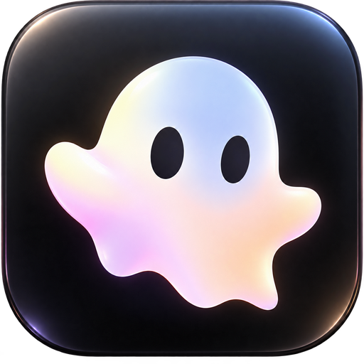
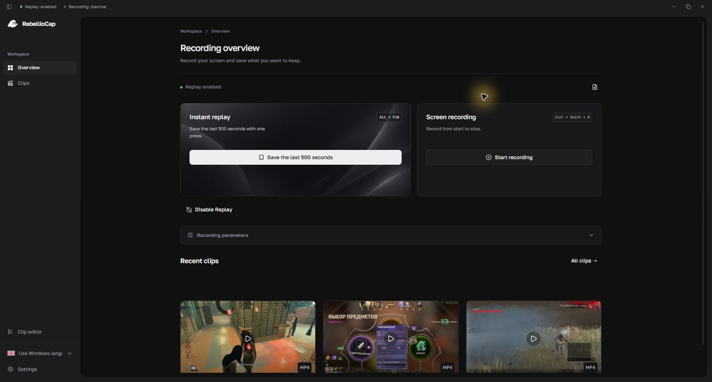
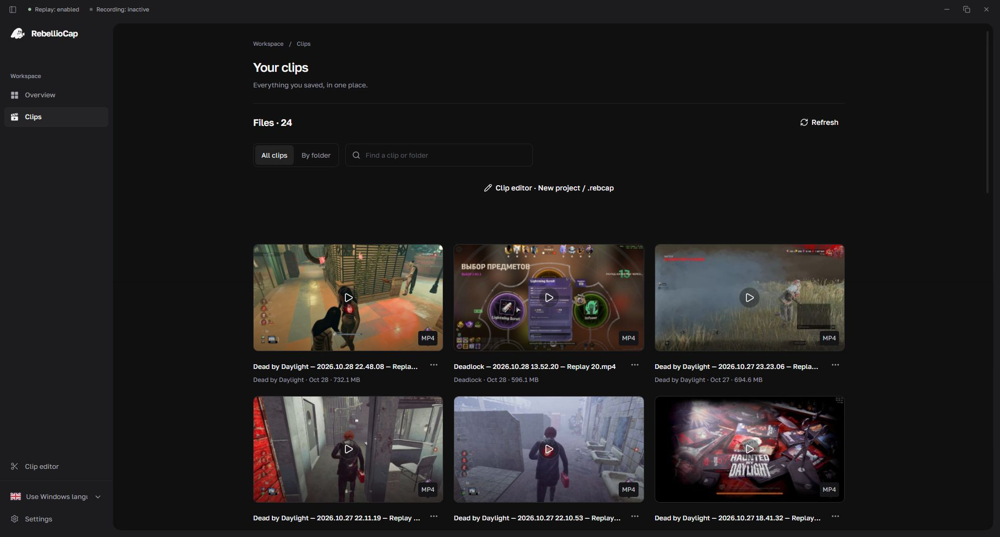
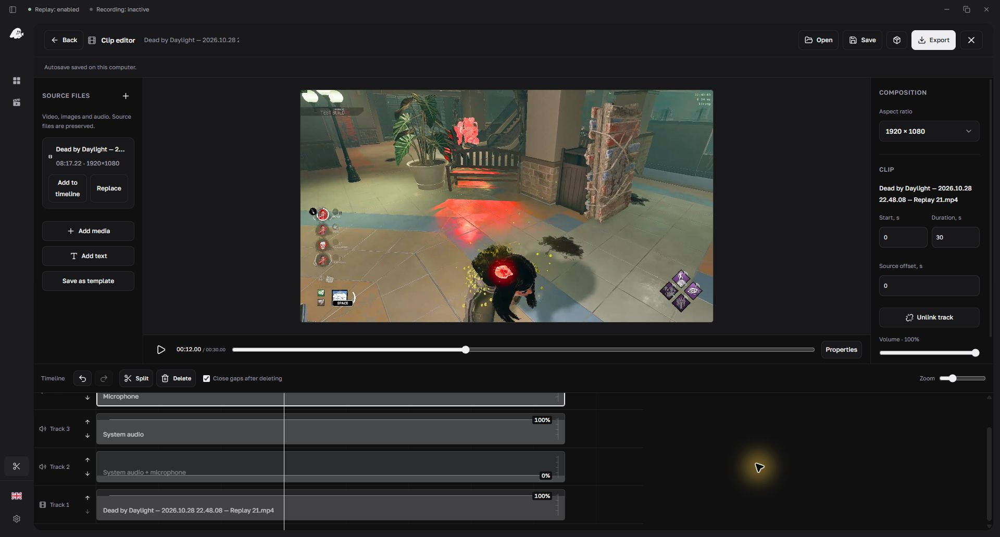
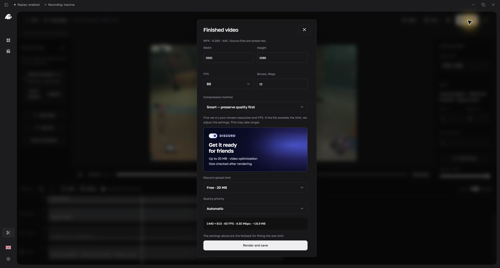
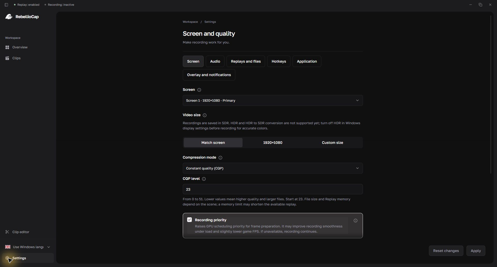
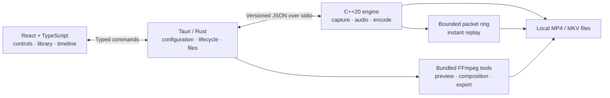

<div align="center">



# RebellioCap

**Record your game. Save the moment. Make the clip.**

Gameplay recording, instant replay, and a built-in clip editor for Windows and NVIDIA GPUs.

[](https://github.com/kirzep/RebellioCap/releases/latest)

[](https://github.com/kirzep/RebellioCap/actions/workflows/desktop-ci.yml)


[Download](https://github.com/kirzep/RebellioCap/releases/latest) · [Get started](docs/getting-started.md) · [Requirements](docs/system-requirements.md) · [Help](docs/troubleshooting.md)

**English** · [Русский](README.ru.md)

</div>



*Actual Windows application with the owner's gameplay recordings. Screenshots use the English interface; English and Russian are supported. [Screenshot details](docs/screenshots/README.md).*

## Save what just happened

Keep instant replay running while you play, then press **Alt + F10** to save the moment after it happens. Record a full session alongside replay, find a clip in your library, and trim or edit it without leaving RebellioCap. Recordings stay on your computer.

| Feature | What you can do |
| --- | --- |
| **Instant replay** | Save recent footage with a hotkey. Choose a replay duration and an automatic or manual RAM budget. The available history can shorten when the memory limit is reached. |
| **Session recording** | Start and stop an MP4 or MKV recording while instant replay runs alongside it. |
| **Recording quality** | Use NVIDIA NVENC H.264 with bitrate-based VBR or constant-QP CQP. Choose source resolution, 1080p, or a custom video size, and configure FPS. |
| **Recording priority** | Optionally raise GPU frame-preparation priority. This can help under load, at the cost of some game FPS; results depend on hardware and workload. |
| **Audio and tracks** | Record system audio and an optional microphone. When both are enabled, keep mixed and separate tracks; select tracks during playback and editing. |
| **Clip library** | Browse thumbnails, search clips and folders, group by folder, preview recordings, rename files, and open a clip in the editor. |
| **Timeline editor** | Trim, split, duplicate, and arrange linked video/audio clips. Add images and text, adjust framing, opacity, color, and volume, and undo or redo changes. |
| **Export for sharing** | Create MP4/H.264/AAC video. Choose Smart, Fit to size, or Fast compression, with 20 / 50 / 500 MB targets and motion, detail, or resolution/FPS priorities. |
| **Projects and recovery** | Save `.rebcap` projects and templates, optionally copy source media with a project, and restore local editor autosaves. Eligible interrupted recordings can be recovered when enough data remains. |
| **Names and folders** | Build recording-name presets from game, date, time, counter, recording type, resolution, and FPS. Save into game folders or a single output folder. |
| **Overlay and sounds** | Arrange recording/replay indicators and messages in the overlay editor. Choose notification sounds, import a custom sound, and set its volume. |
| **Desktop controls** | Configure global hotkeys, run from the tray, optionally start with Windows, and install available published updates from the app. |

Capture records the **whole selected display**, including other visible windows and notifications. Game folders organize recordings; capture of a selected game window and per-application audio isolation are not currently enabled.

## From recording to finished clip

### Find your recording



Browse your recordings, preview a moment, select its audio tracks, and choose **Edit clip** from its menu.

### Make the cut



Work on a timeline with linked video and audio, snapping, ripple deletion, and direct preview positioning and resizing. Add text or image layers, change the composition for horizontal, vertical, or square video, and save a project to continue later. Source files are preserved.

### Fit the upload limit



- **Smart** first tries your chosen resolution and FPS with a quality target. If that output exceeds the selected limit or the profile is unavailable, it falls back to bitrate-budgeted encoding.
- **Fit to size** starts directly with the bitrate budget and thorough encoding settings.
- **Fast** uses the lighter encoding profile.

Choose whether to favor smooth motion, detail, or **keep resolution and FPS**. Each completed attempt is checked against the actual byte limit before saving. If the limit cannot be met, export reports an error instead of saving an oversized result. The app's 20 / 50 / 500 MB presets are size targets; check the upload limit available to your account.

The thorough profile uses NVENC when supported, with basic NVENC and Windows Media Foundation fallbacks. Smart compression can take longer. A small file-size target can still reduce visible detail; keeping resolution and FPS does not guarantee lossless quality.

<details>
<summary><strong>Recording settings</strong> — display, video size, FPS, VBR/CQP, and recording priority</summary>

<br>


VBR uses a configured bitrate. CQP uses a quantization level: lower values generally preserve more detail and produce larger files. CQP file sizes and replay-memory use depend on the scene. Settings include contextual help for these tradeoffs.

</details>

## Get started

1. Download the **Windows EXE installer** from [GitHub Releases](https://github.com/kirzep/RebellioCap/releases/latest).
2. Complete setup: choose your display, audio sources, output folder, replay settings, and hotkeys. Run the built-in test recording.
3. Play with Replay enabled. Press **Alt + F10** to save recent footage or **Ctrl + Shift + R** to start/stop a session recording.
4. Open **Clips**, choose a recording, and edit or export it.

Both shortcuts can be changed in Settings. Replay saves only the footage still retained in the buffer: a new session, recovery, or a memory limit can result in a shorter clip.

The interface supports **English and Russian**, follows the Windows display language by default, and has a language selector in the sidebar. This README describes the current source tree; the features included in a published installer are recorded in its [release notes](https://github.com/kirzep/RebellioCap/releases).

## Requirements and current limitations

- **Windows x64**, an **NVIDIA GPU with compatible NVENC H.264 support**, and **WebView2** are required for recording. AMD/Intel capture encoders and other operating systems are not implemented. See [system requirements](docs/system-requirements.md) for the OS/driver baseline and runtime checks.
- Capture includes the selected display's visible contents. It does not isolate a game window or an application's audio.
- Video is **SDR BT.709**; HDR fidelity and tone mapping are not implemented.
- Replay stores encoded packets in RAM. Its memory limit covers retained compressed data, not total application or GPU memory. CQP output size depends on the scene.
- Resolution/FPS limits in Settings are validation bounds, not a promise that every GPU can sustain those settings. Recording priority can affect game performance.
- Recovery cannot reconstruct frames that were never captured or bytes that were never written. Source media, previews, and exports also need free disk space.
- Project files and diagnostics can contain local paths. See [privacy](docs/privacy.md) before sharing them.

## For developers

The native C++20 engine owns capture, audio, encoding, replay, and muxing. A Rust/Tauri host supervises the engine and owns configuration and file access. React/TypeScript provides the interface, library, and timeline editor. Bundled FFmpeg tools handle editor preview and export.

Build on Windows with MSVC C++ Build Tools and the Windows SDK, CMake/Ninja, Node.js 24 with npm, and Rust 1.90+ with the MSVC target. The [step-by-step guide](docs/getting-started.md) covers prerequisite installation and first-run checks.

```powershell
git clone https://github.com/kirzep/RebellioCap.git
Set-Location RebellioCap
./scripts/verify-prerequisites.ps1
./scripts/bootstrap-vcpkg.ps1
npm ci
./scripts/invoke-dev.ps1 -Command @('cmake', '--preset', 'windows-debug')
./scripts/invoke-dev.ps1 -Command @('cmake', '--build', '--preset', 'windows-debug')
./scripts/stage-desktop-engine.ps1 -BuildDirectory build/windows-debug
npm run desktop:dev
```

Wait for each command to complete successfully before continuing.



The [architecture guide](docs/architecture.md) explains GPU resource ownership, shared audio/video clocks, replay memory limits, process boundaries, and recovery behavior, with links to implementation and tests.

| Area | Location |
| --- | --- |
| Native capture, audio, encoding, replay, muxing | [`src/`](src/) |
| Desktop UI, onboarding, library, editor | [`apps/desktop/src/`](apps/desktop/src/) |
| Rust host, process supervision, media orchestration | [`apps/desktop/src-tauri/`](apps/desktop/src-tauri/) |
| Shared recording validation | [`contracts/`](contracts/) |
| Native and script tests | [`tests/`](tests/) |
| Build, staging, recovery and measurement tools | [`scripts/`](scripts/) |

### Run checks

```powershell
# C++, Rust, frontend checks, production bundle, and CSP assertion.
./scripts/verify-desktop.ps1

# Browser acceptance is a separate gate.
npx playwright install chromium
npm run test:e2e -w @rebelliocap/desktop

# Crash-media coverage verifier tests.
npm run test:crash-coverage
```

The [Windows CI workflow](.github/workflows/desktop-ci.yml) runs software and browser checks. Browser fixtures exercise UI behavior; actual WebView2, GPU capture, device recovery, long sessions, and installers have separate validation requirements. See [testing](docs/testing.md) for commands and coverage boundaries.

## Documentation and help

[Documentation index](docs/README.md) · [Troubleshooting](docs/troubleshooting.md) · [Support](SUPPORT.md) · [Changelog](CHANGELOG.md)

[Contributing](CONTRIBUTING.md) · [Security reports](SECURITY.md) · [Privacy](docs/privacy.md) · [Community expectations](CODE_OF_CONDUCT.md)

## Licensing

The source is publicly available for inspection. **No project-wide open-source license is currently granted.** See [licensing status](LICENSE.md). Third-party components retain their own licenses and notices; their details and redistribution boundaries are recorded in [third-party licenses](docs/licenses/third-party.md).
